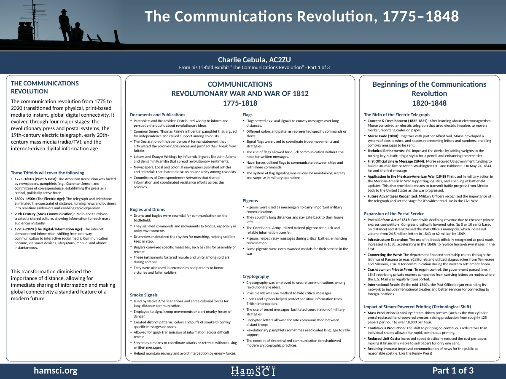
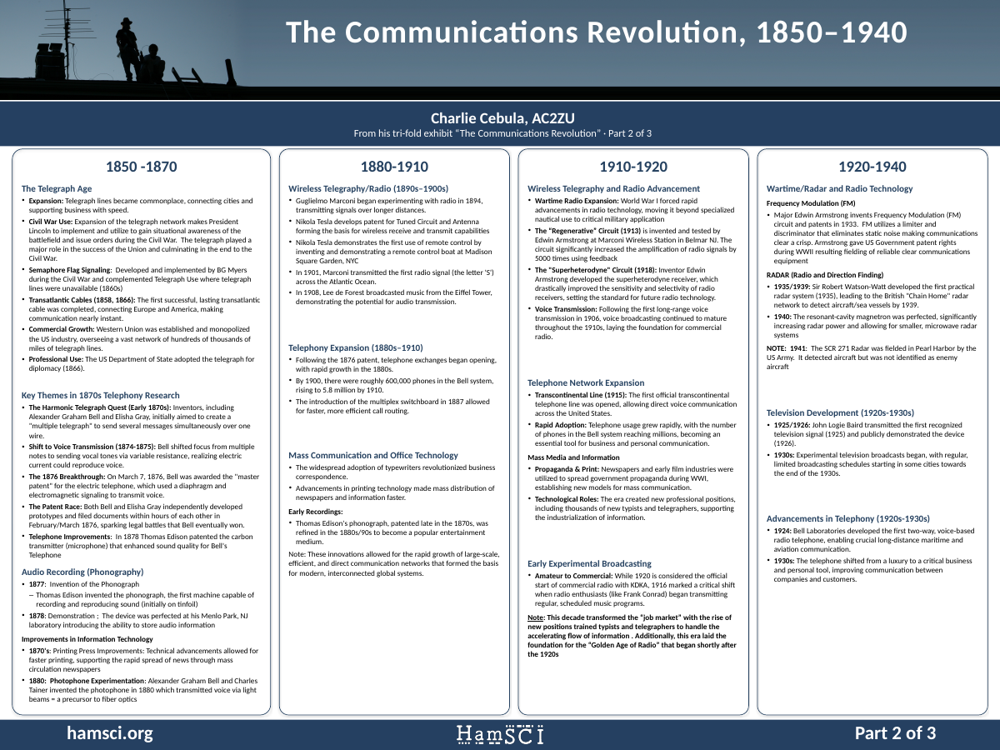
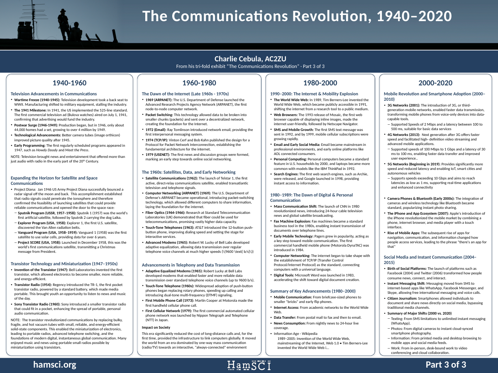

# Posters

Three 48 × 36 in posters on the HamSCI poster template (blue), one per original tri-fold board.

| Poster | PowerPoint | PDF |
|---|---|---|
| 1: 1775–1848 | [`poster_1_1775-1848.pptx`](poster_1_1775-1848.pptx) | [`poster_1_1775-1848.pdf`](poster_1_1775-1848.pdf) |
| 2: 1850–1940 | [`poster_2_1850-1940.pptx`](poster_2_1850-1940.pptx) | [`poster_2_1850-1940.pdf`](poster_2_1850-1940.pdf) |
| 3: 1940–2020 | [`poster_3_1940-2020.pptx`](poster_3_1940-2020.pptx) | [`poster_3_1940-2020.pdf`](poster_3_1940-2020.pdf) |





## What's on them

The text is the verbatim transcription in [`../transcription/`](../transcription/), errors
included. None of the corrections suggested in the transcriber notes have been applied. Only the
transcriber markup is removed:
- annotations such as "(Title printed in bold.)" and the `[image: …]` note;
- the `[red]` markers for text that was red on the boards, now in the normal text color;
- the `[?x?]` brackets around uncertain readings, using the best reading `x`.

Each column of a board becomes one rounded column box, headed by the board's header card, with
the board's panels stacked inside in their original order. On poster 1, the six
Revolutionary War panels sit in two sub-columns as on the board. The intro and closing
statement are set larger, as they were on the board.

The template's footer carries five logos (Scranton, HamSCI, NSF, NASA Partner, ARDC). These
outreach posters aren't sponsored work, so the build keeps only the HamSCI logo, centered.

The printing-press photo from the board 1 steam-printing panel is not included: the board
photo is too low-resolution to reuse it.

## Rebuilding

The posters are generated, so edit the transcription or the script, never the `.pptx` by hand.

```bash
python3 -m venv .venv && .venv/bin/pip install -r posters/requirements.txt
.venv/bin/python posters/build_posters.py    # writes posters/*.pptx
.venv/bin/python posters/check_text.py       # every transcription line is on its poster
cd posters && soffice --headless --convert-to pdf poster_*.pptx
for f in poster_*.pdf; do pdftoppm -r 25 -png -singlefile "$f" "preview_${f%.pdf}"; done
```

`build_posters.py` reads the template from
`~/hamsci/presentation_templates/poster/pptx/hamsci_poster_template.pptx`
([`HamSCI/presentation_templates`](https://github.com/HamSCI/presentation_templates)). Use
`--template` or `HAMSCI_POSTER_TEMPLATE` to point it elsewhere.

**Text sizing.** The script measures the text with Carlito, which has the same letter widths as
Calibri, the template's font (Debian/Ubuntu package `fonts-crosextra-carlito`). It picks the
largest body size at which every column of every poster fits: 26.5 pt, with panel headings at
1.22 × that and column headers at 54 pt. No column is more than 1.2 × the average width.
Spare height goes between the panels.
